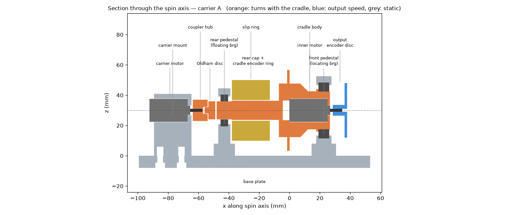

# Nested DC-Motor Rotation Experiment

### EVERYTHING HERE WAS CREATED BY CLAUDE, INCLUDING THE ORIGINAL PLAN. I ASKED FOR A MOTOR THAT ROTATES ANOTHER MOTOR

One DC motor (the **carrier**) spins the whole body of a second DC motor (the
**inner** motor) while the inner motor's own rotor turns inside it. Measure how the
output speed composes. The original plan is
[docs/Nested DC-Motor Rotation Experiment.md](docs/Nested%20DC-Motor%20Rotation%20Experiment.md);
this repository implements it.



**3D view:** open [`cad/exports/rig_assembly.step`](cad/exports/rig_assembly.step) in any CAD viewer (FreeCAD, Fusion, Onshape, or an online STEP viewer). It contains the whole running rig, with every part named and colored: orange spins with the cradle, blue turns at output speed, light grey is static.

## Repository

| Path | Contents |
|---|---|
| `cad/parameters.py` | Every dimension, fit and part choice. Motor sizes are read from `data/motor_dims.csv` |
| `cad/rig.py` | Parametric build123d model of all parts. Clearance checking, STL/STEP export, BOM generation |
| `data/` | Measurement CSVs: `motor_dims.csv`, `motor_A.csv`, `motor_B.csv`, `combined_runs.csv`, `spinup_*.csv`. `data/example/` holds synthetic samples of each |
| `analysis/` | Motor model and fitting, carrier selection, predicted vs measured, serial logger, self-test |
| `firmware/tachometer/` | Arduino two-channel optical tachometer (summary and raw-pulse modes) |
| `docs/` | Design notes, test procedure, assembly, generated BOM |

## Workflow

```
pip install -r requirements.txt

# Phase 0: caliper motors -> data/motor_dims.csv, then
python cad/rig.py --carrier both          # STLs + STEPs -> cad/exports/, BOM -> docs/BOM.md

# Phase 1: bench data -> data/motor_A.csv, data/motor_B.csv (docs/PROCEDURE.md)
python analysis/characterize.py
python analysis/select_carrier.py --vc 3 --vi 3 --parasitic-mNm <measured>

# Phase 3: combined runs -> data/combined_runs.csv
python analysis/compare_runs.py --r-slip <ohm>   # -> analysis/RESULTS.md

python analysis/selftest.py                # pipeline check on synthetic data
```

## Key engineering findings (details in [docs/DESIGN_NOTES.md](docs/DESIGN_NOTES.md))

1. **The two motors are in series: same torque, speeds add.** In steady state the
   inner motor's internal friction cancels inside the nested assembly. The only
   torque it feeds back into the carrier is the external output load. So the
   carrier carries τ_out plus the cradle's parasitic drag, and the inner motor
   carries τ_out alone.
2. **The plan's formula only holds at zero load.** On synthetic data with realistic
   parameters, it is off by 44% at moderate load, while the series model stays
   within a few percent. The role-swap effect is predicted exactly: it is
   τ_par × the difference in the two motors' speed-torque slopes.
3. **The slip ring is the main stall risk.** Its drag, and its maximum-speed
   rating, matter more than the inner motor's reaction torque. Phase 1 now measures
   it.
4. **The rope brake replaces the wound-cord dynamometer**, which cannot hold a
   steady point at motor speeds. A spin-up/inertia method gives an independent
   cross-check.
5. **Kinematic mounting.** An Oldham coupling and a locating/floating bearing pair
   keep the cradle axis from being over-constrained. A second encoder on the cradle
   measures ω_carrier at the same time as ω_out.

## Status

- CAD builds and passes its clearance checks in both role configurations, **using
  ASSUMED generic 130-size motor dimensions and assumed slip-ring and sensor
  sizes.** Replace these before printing (DESIGN_NOTES §7).
- The analysis pipeline is validated on synthetic data (`analysis/selftest.py`).
  No real measurements have been taken yet.

## License

[MIT](LICENSE)
