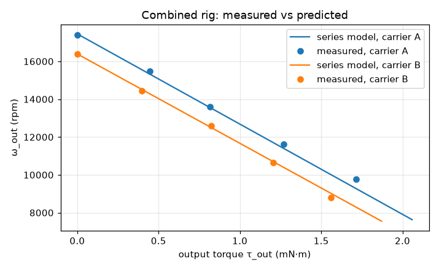

# Results — predicted vs measured composite speed

_Generated by `python analysis/compare_runs.py`; re-run after adding rows to combined_runs.csv._

| Run | Carrier | V_c | V_i | τ_out (mN·m) | ω_out meas (rpm) | plan pred | plan dev % | series pred | series dev % | cradle meas / pred (rpm) | rel meas / pred (rpm) | inner reaction vs τ_out (mN·m) |
|---|---|---|---|---|---|---|---|---|---|---|---|---|
| 2 | A | 3 | 3 | 0.00 | 17401 | 17497 | -0.6 | 17453 | -0.3 | 7447 / 7489 | 9954 / 9964 | 0.01 vs 0.00 |
| 3 | A | 3 | 3 | 0.45 | 15471 | 17497 | -11.6 | 15328 | +0.9 | 6793 / 6763 | 8678 / 8564 | 0.41 vs 0.45 |
| 4 | A | 3 | 3 | 0.82 | 13614 | 17497 | -22.2 | 13557 | +0.4 | 6164 / 6159 | 7450 / 7398 | 0.80 vs 0.82 |
| 5 | A | 3 | 3 | 1.27 | 11636 | 17497 | -33.5 | 11392 | +2.1 | 5483 / 5420 | 6153 / 5973 | 1.22 vs 1.27 |
| 6 | A | 3 | 3 | 1.72 | 9773 | 17497 | -44.1 | 9267 | +5.5 | 4859 / 4694 | 4914 / 4573 | 1.60 vs 1.72 |
| 8 | B | 3 | 3 | 0.00 | 16377 | 16414 | -0.2 | 16392 | -0.1 | 7687 / 7692 | 8690 / 8699 | 0.01 vs 0.00 |
| 9 | B | 3 | 3 | 0.40 | 14440 | 16414 | -12.0 | 14521 | -0.6 | 6468 / 6524 | 7972 / 7997 | 0.39 vs 0.40 |
| 10 | B | 3 | 3 | 0.83 | 12609 | 16414 | -23.2 | 12494 | +0.9 | 5315 / 5258 | 7294 / 7236 | 0.78 vs 0.83 |
| 11 | B | 3 | 3 | 1.20 | 10645 | 16414 | -35.1 | 10701 | -0.5 | 4100 / 4139 | 6545 / 6562 | 1.21 vs 1.20 |
| 12 | B | 3 | 3 | 1.56 | 8783 | 16414 | -46.5 | 9025 | -2.7 | 2929 / 3092 | 5854 / 5933 | 1.60 vs 1.56 |

Deviation = (measured − predicted) / predicted. *plan* = baseline cradle speed + inner bench free speed; *series* = series model with measured parasitic torque.

## Notes

- Carrier A: baseline cradle speed 7469 rpm at 3 V (bench free speed 8770 rpm); parasitic torque from the carrier current: **0.79 mN·m** (= 15% of its stall torque).
- Carrier B: baseline cradle speed 7644 rpm at 3 V (bench free speed 10028 rpm); parasitic torque from the carrier current: **0.79 mN·m** (= 23% of its stall torque).

Phase 1 fits: [motor_summary.md](motor_summary.md) · carrier choice: [carrier_selection.md](carrier_selection.md)
